# FarmDogs Launcher

**Jugar, seedear, elegir equipo y consultar tu VIP de Wardogs desde Windows.**

FarmDogs Launcher reúne los cinco servidores de Wardogs Spain, entrada automática por ID, presencia de tu clan, selección de equipo y movimiento temporal anti-AFK. Funciona en tu PC y guarda allí su configuración. Tiene identidad visual propia: un perro tecnológico y tipografía Rajdhani Bold. Es un proyecto independiente, sin afiliación con Wardogs ni Wardogs Spain.

[Descargar el portable](https://github.com/wasonidas/FarmDogs/releases/latest) · [Ver las versiones](https://github.com/wasonidas/FarmDogs/releases) · [Licencia MIT](LICENSE)

**FarmDogs Launcher 0.5.2** mejora la entrada programada y por actividad, el reconocimiento del personaje y la cancelación por F8. Conserva las correcciones de componentes y cierre de la 0.5.1, la presencia del clan y el equipo aleatorio o elegido. Consulta las comprobaciones y los límites de la versión más abajo.

## Descargar y abrir

Para usar FarmDogs no necesitas compilar ni instalar Node.js.

1. Abre la [última versión publicada](https://github.com/wasonidas/FarmDogs/releases/latest) y descarga **FarmDogs-portable.zip** en sus archivos adjuntos. Las versiones preliminares, si existen, aparecen en [Versiones](https://github.com/wasonidas/FarmDogs/releases).
2. Extrae **toda la carpeta** en una ubicación donde puedas guardar archivos.
3. Abre **FarmDogs.exe**.

Conserva las carpetas `bin`, `src` y `public` junto al ejecutable. El ZIP incluye Node.js; **FarmDogs.exe es el lanzador de la carpeta completa**, no un ejecutable independiente.

Necesitas Windows 10/11 x64, el runtime Microsoft Edge WebView2, reconocimiento OCR de Windows disponible para tus idiomas y Steam/Wardogs instalados. El lector aprovecha también el reconocedor en inglés cuando está instalado. El archivo **Source code** que GitHub genera en cada versión contiene las fuentes; para jugar con la aplicación ya compilada descarga **FarmDogs-portable.zip**.

### Actualizar sin perder tus ajustes

**Desde 0.3.0:** la primera actualización a una versión con actualizador es manual. Cierra FarmDogs Launcher, extrae toda la versión nueva en otra carpeta y pasa tu carpeta `data` a esa carpeta antes de abrirla. Ahí se guardan los ajustes y el perfil de cuenta. No compartas esa carpeta con el clan: cada persona debe utilizar sus propios datos.

**Desde 0.4.0:** la tarjeta **Actualizaciones** permite dejar marcada **Actualizar automáticamente**, usar **Buscar actualización** o pulsar **Instalar y reabrir**. FarmDogs consulta únicamente las versiones estables de `wasonidas/FarmDogs`, descarga el portable y comprueba su SHA-256, las rutas y el manifiesto de archivos.

Las publicaciones marcadas como **pre-release** en GitHub se descargan manualmente desde Versiones; el actualizador no las instala automáticamente.

La instalación espera a que no haya entrada, movimiento, autoclic, búsqueda, programación ni una operación de premios en marcha. Conserva `data`, cierra FarmDogs y vuelve a abrirlo sin reactivar sesiones anteriores. Si falla el reemplazo de archivos, intenta restaurar la versión anterior; si la restauración no puede completarse, informa del error y conserva la copia de seguridad. Este proceso se aplica al portable, no a la carpeta de desarrollo del repositorio.

## Qué puedes hacer

| Función | Para qué sirve | ¿Requiere conectar Steam a FarmDogs? |
| --- | --- | --- |
| **Anti-AFK** | Movimiento temporal para una ausencia breve en tu partida actual. | No |
| **JUGAR** | Ver servidores y clan; elegir destino/equipo y completar la entrada por ID. | No para entrar; sí para identificar tu clan |
| **SEEDING** | Completar la entrada y preparar movimiento ahora, a una hora o al detectar actividad. | No para la cadena de entrada; sí para consultar presencia privada y premios |
| **EQUIPO** | Intentar entrar automáticamente en azul, rojo o verde. | No |
| **MI VIP** | Consultar cuenta, progreso y premios pendientes. | Sí |

**Anti-AFK** permanece visible encima de las cuatro pestañas. La conexión de Steam mencionada en la tabla es la de la cuenta web de FarmDogs. Para abrir el juego se necesita Steam instalado y una sesión recordada válida. **Steam y Wardogs pueden estar cerrados**: FarmDogs solicita su apertura y continúa la entrada cuando reconoce el juego. Si Steam pide contraseña o Steam Guard, debes autenticarte tú.

## Anti-AFK para una pausa

Puedes usarlo dentro de cualquier servidor de Wardogs, sin esperar población y sin elegir un servidor en la aplicación.

1. Estando desplegado, deja las **manos vacías**, los menús cerrados y espacio a ambos lados del personaje.
2. Elige **5, 15 o 30 minutos**, o escribe tu propia duración.
3. Marca **Estoy desplegado y con las manos vacías** y pulsa **Activar anti-AFK**.
4. Vuelve a Wardogs y déjalo en primer plano.

FarmDogs espera a reconocer la interfaz del personaje desplegado y alterna pasos a izquierda y derecha. En **Configurar movimiento** puedes ajustar:

| Ajuste | Valor inicial | Rango |
| --- | --- | --- |
| Duración máxima | 15 minutos | 1–720 minutos |
| Tiempo entre pasos | 30 segundos | 5–300 segundos |
| Duración de cada paso | 500 ms | 100–2000 ms |

**Detener** o **F8** cancelan la sesión. También termina al agotarse el tiempo elegido. Si abres un menú, pierdes el foco o deja de reconocerse el personaje, los pasos se pausan; solo reanudan con una captura válida nueva. El tiempo sigue contando durante las pausas. Una sesión cancelada no vuelve a arrancar sola.

Este modo no abre el juego, redespliega ni reconecta al personaje. Tampoco comprueba seeding ni concede por sí mismo días VIP.

## JUGAR: servidor, clan y entrada automática

En **JUGAR** verás los cinco servidores de Wardogs Spain y su población, consultada cada 30 segundos.

1. Elige servidor y **Equipo**: **Aleatorio · primero disponible**, azul, rojo o verde.
2. Pulsa **Entrar automáticamente** y deja **Wardogs en primer plano**.
3. Sigue la tarjeta **Entrada automática**: Abrir juego → Entrar al servidor → Elegir equipo → Desplegar.

FarmDogs reconoce las pantallas del juego, abre la entrada por ID, escribe el destino, busca el servidor y comprueba su confirmación antes de conectar. Después intenta entrar en el equipo elegido hasta leer **DESPLEGANDO** y espera un HUD reciente del personaje desplegado. Abrir el juego, escribir el ID o ver el selector no bastan para declarar la entrada completada.

**Aleatorio · primero disponible** elige al azar entre los equipos que estén disponibles en el selector reconocido. Es útil si quieres entrar cuanto antes y no necesitas coincidir con tu clan. Si eliges un color concreto, mantiene los intentos sobre ese equipo hasta DESPLEGANDO o una parada. No cambia de color por su cuenta para acelerar la entrada.

El botón **Desplegar** del menú principal aparece gris mientras carga y todavía no acepta clics. FarmDogs espera a reconocerlo a pleno color antes de pulsarlo. En el selector de equipos mantiene el clic continuo aunque el color del equipo esté apagado por equilibrio.

Al comenzar intenta poner Wardogs delante **una sola vez** y continúa desde su pantalla de inicio cuando la reconoce. Si Windows no permite activarlo, te pide volver al juego. Después respeta **Alt+Tab**: no recupera el foco repetidamente. Mantén el juego delante durante la entrada; si sales mientras el autoclic está en marcha, tendrás que iniciar otro intento. **F8** cancela también durante el arranque y el reconocimiento.

Mientras avanza, la app muestra un aviso grande: **FarmDogs está trabajando. No necesitas tocar nada**, junto al paso actual. Las cargas pueden tardar: espera a que reconozca la siguiente pantalla y deja Wardogs delante. **F8** o **Detener entrada** siguen disponibles durante la espera.

Puedes empezar con Steam y el juego cerrados, o desde los menús de entrada de Wardogs. Si ya estás desplegado y solo quieres movimiento, usa Anti-AFK o la confirmación manual de SEEDING. Durante la cadena, una pantalla no reconocida queda en espera; un error de servidor, reinicio o regreso a un menú tras confirmar el destino detiene el intento. No hay reconexión automática. **Detener entrada** y **F8** cancelan sin volver a intentarlo solos.

Si la instalación no dispone del controlador de entrada, el botón muestra **Abrir Wardogs y copiar ID**. En ese modo completa tú la entrada y el despliegue. Si no se puede copiar el ID, sigue visible para copiarlo manualmente.

### Cuando el servidor está lleno

FarmDogs reconoce la cola del servidor y espera plaza sin repetir la búsqueda ni abandonar la cola por su cuenta. Al entrar, continúa con el equipo elegido. **La cola consume la duración máxima de tu sesión**, igual que las cargas, la selección de equipo y el movimiento. Ajusta ese tiempo antes de empezar: no se añade otro plazo al llegar al selector. Al agotarse, la automatización termina.

La parada del autoclic al leer **DESPLEGANDO** y el estado **Entrada completada** son pasos distintos. Para completar la entrada, FarmDogs también debe reconocer el HUD del personaje desplegado. El movimiento de SEEDING espera después sus propias condiciones.

### Ver dónde está tu clan

Conecta Steam desde **MI VIP** para identificar el clan registrado en tu cuenta de Wardogs Spain. Después, cada servidor muestra un piloto y el número de miembros reportados:

- **Verde:** la fuente reciente informa de al menos un miembro del clan en ese servidor.
- **Cero miembros:** una lectura válida no informa de miembros allí.
- **Sin datos, lectura caducada o sin comprobar:** no se conoce el recuento; no equivale a cero.

Al dejar el cursor sobre el indicador verás el clan y el reparto azul/rojo/verde, cuando estén disponibles. La asociación con tu clan procede de la lectura privada autorizada de tu cuenta; los recuentos proceden del endpoint público de ese clan. La web los actualiza aproximadamente **cada minuto**, por lo que pueden llevar retraso. **Puedes estar incluido en el recuento**: no se presenta como número de compañeros distintos de ti. La app no conserva nombres ni SteamID de los integrantes del listado público.

No requiere Discord, una clave API de Steam ni permisos para administrar el clan. Si falta información de asociación, FarmDogs muestra estado desconocido; solo una respuesta explícita sin clan permite mostrar **Sin clan vinculado**.

## SEEDING: entrada y movimiento programables

Elige servidor en **JUGAR**, después abre **SEEDING**. En **Equipo al entrar** deja **Aleatorio · primero disponible (recomendado)** o elige el color de tu clan. Ajusta la duración y cómo comenzar:

- **Ahora:** pulsa **Entrar y seedear** para completar entrada, equipo y despliegue, y preparar el movimiento.
- **A una hora:** programa fecha y hora de Madrid. Con **Activar también el movimiento automático**, la entrada entrega el control a seeding; sin marcarlo, termina después del despliegue.
- **Al haber actividad:** pulsa **Buscar servidor**. Observa la API pública, confirma actividad en dos lecturas válidas y elige un destino que esté empezando a llenarse. Por defecto busca entre 1 y 19 jugadores. Después completa la misma cadena de entrada con el equipo elegido.

El movimiento de seeding espera el umbral configurado —**20 jugadores por defecto**—, entrada o presencia confirmada y una captura reciente del personaje desplegado con manos vacías. La cadena de entrada verificada identifica el servidor, proceso y ventana sin exigir conectar la cuenta web de Steam a FarmDogs. El umbral de movimiento no determina la regla del premio VIP.

Si ya estás dentro, marca **Ya estoy desplegado en el #…** y pulsa **Activar movimiento**: no abre de nuevo el juego y utiliza tu confirmación para esa sesión. Con Steam conectado a FarmDogs también puede comprobarse presencia privada. La confirmación manual y la cadena visual no comprueban por sí mismas progreso ni premios.

El equipo de Seedear se conserva para Ahora, A una hora y Al haber actividad. Cambiar ese ajuste no cambia de equipo a un personaje ya desplegado.

Si se cierran nuevas admisiones, pero la cuenta y el servidor siguen confirmando tu ciclo, aparece **Continuar seeding**. La sesión puede continuar sin abrir otra vez el juego.

La programación y la búsqueda iniciadas desde el launcher pueden activar el juego una sola vez al comenzar la entrada. El permiso queda ligado al trabajo y a su destino; una intervención nueva fuera del juego durante el arranque lo revoca. Si Windows no cede el foco, FarmDogs avisa para volver al juego. Para cancelar una espera programada o por actividad, usa su botón Cancelar/Detener; F8 cancela los controles cuando la entrada ya está en marcha.

La duración incluye búsqueda, entrada, espera y movimiento. Las programaciones necesitan el PC despierto, FarmDogs abierto y una sesión de Steam válida recordada; al entrar, Wardogs debe estar en primer plano. Se interrumpen al reiniciar y no ejecutan una hora perdida por más de un minuto. La búsqueda por actividad no lee mensajes de Discord ni acredita las ventajas de responder a una llamada del staff.

El movimiento se pausa al abrir menús, perder el foco o no reconocer el HUD; solo reanuda con una captura válida nueva. El autoclic ya iniciado se cancela si pierde el foco. F8 o Detener cancelan la cadena y sus controles, sin rearmado automático.

## EQUIPO: entrar en el color de tu clan

1. Abre **EQUIPO**, selecciona **azul, rojo o verde** y pulsa **Esperar equipo**.
2. Entra al servidor desde Wardogs y deja el juego delante.
3. Cuando aparezca el selector de facciones, FarmDogs reconoce la tarjeta elegida y empieza a clicar.
4. Al leer **DESPLEGANDO**, detiene y desarma el autoclic.

No necesitas teclas de inicio, colocar el cursor ni guardar coordenadas. El intervalo entre clics se puede ajustar entre **20 y 2000 ms**.

Una vez reconocida la tarjeta, el clic continúa aunque el color se apague por equilibrio de equipos o desaparezca el selector. **ENTRANDO**, un cambio de color o la aparición del HUD no sustituyen la confirmación **DESPLEGANDO**.

Antes de adquirir la tarjeta puedes alternar entre FarmDogs y el juego. Una vez clicando, perder el foco, cambiar la ventana o su tamaño, pulsar una tecla modificadora o un error cancela el intento. Para repetir, pulsa **Esperar equipo** otra vez. **Cancelar** y **F8** también terminan la espera o los clics.

Cambiar color o velocidad durante la espera la cancela antes de aplicar los nuevos ajustes. Esta pestaña sirve cuando tú completas la entrada al servidor. En **JUGAR** o **SEEDING**, la cadena automática coordina el mismo selector y espera su desarme antes de entregar el control al movimiento. No actives dos automatismos por separado.

## Avisos grandes y sonido

FarmDogs avisa cuando una acción necesita **Wardogs en primer plano**. La ventana de aviso es grande, funciona con FarmDogs minimizada y no cambia la ventana activa. Se oculta al volver al juego. Distingue falta de foco de una pantalla o un HUD que no se reconoce.

Si la selección de equipo se cancela por perder el foco, el aviso explica que debes reactivar **Esperar equipo**.

- **Avisos con sonido:** activa o silencia el sonido de FarmDogs.
- **Probar aviso:** presenta un ejemplo de tres segundos.

Los avisos automáticos se deduplican y tienen un intervalo mínimo entre sonidos. No cambian el volumen del juego. Para recibir el aviso fuera del navegador, utiliza **FarmDogs.exe**.

## MI VIP: cuenta de Steam y premios

Conecta Steam desde **MI VIP** para consultar estado VIP, progreso, premios y asociación con tu clan. El inicio de sesión se realiza en la web oficial dentro del perfil WebView2 de la aplicación. Puedes **Ocultar y seguir leyendo** sin mantener visible esa ventana; **Detener lectura** desconecta el lector y conserva la sesión web. No necesitas una clave API de Steam ni copiar cookies desde otro navegador.

La protección **Cobrar antes de caducar** espera a que Wardogs publique la **fecha final de cobro** y actúa con la antelación guardada, 15 minutos por defecto. No cobra el premio de la semana en curso solo por activarla. Necesita el PC y FarmDogs abiertos y una lectura autorizada de la cuenta. Un resultado incierto no se repite automáticamente.

FarmDogs no gasta WSP ni compra VIP. Las reglas del servidor pueden cambiar; la población o un VIP histórico no prueban un premio nuevo. La información oficial está en [Wardogs Spain](https://wardogsspain.com/vip).

## Si algo no empieza

| Situación | Qué revisar |
| --- | --- |
| Anti-AFK espera o se pausa | Wardogs delante, personaje desplegado, manos vacías y menús cerrados. |
| Controlador no disponible o componentes distintos | Cierra FarmDogs y vuelve a extraer el portable completo conservando `data`. La app indica qué componente falta o no coincide; esto no significa que una actualización esté en curso. |
| Seeding espera población | Revisa el umbral de seeding. Para una pausa en una partida, usa el acceso Anti-AFK independiente. |
| Selector esperando | Debe verse el selector de facciones dentro de Wardogs. |
| Selector detenido al cambiar de ventana | Vuelve a pulsar Esperar equipo y regresa al juego. |
| Entrada esperando una pantalla | Deja Wardogs delante, en los menús de entrada. Revisa el paso y el mensaje de Entrada automática; no hace clic sobre pantallas desconocidas. |
| Wardogs se abre detrás de otra ventana | Vuelve al juego. FarmDogs solo intenta activarlo una vez al inicio y respeta tus cambios de ventana posteriores. |
| Steam solicita inicio de sesión | Completa tú la autenticación. FarmDogs no introduce credenciales ni códigos de Steam Guard. |
| Entrada detenida por un error | Revisa el motivo y vuelve a iniciarla desde la app. No reconecta ni repite búsquedas de resultado incierto. |
| Lleva tiempo en cola | Revisa la posición y el fin de sesión. La cola consume la duración máxima que elegiste. |
| El autoclic terminó pero sigue Esperando despliegue | DESPLEGANDO ya detuvo los clics; falta reconocer el HUD. Mantén manos vacías, menús cerrados y el juego delante. |
| Un botón está bloqueado | Detén el otro automatismo: movimiento, selector y programación no se ejecutan a la vez. |
| No se oye el aviso | Comprueba Avisos con sonido y Probar aviso; usa la ventana de escritorio. |
| No aparece VIP o progreso reciente | Revisa la conexión de la cuenta en Mi VIP. |
| No aparece el piloto verde del clan | Revisa la lectura Steam y el estado del indicador. Un dato caducado o desconocido no equivale a ausencia de compañeros. |
| Actualización pendiente | Termina o cancela automatismos y programaciones. La copia de desarrollo no se actualiza automáticamente. |

Si la aplicación muestra un error persistente, puedes [abrir una incidencia](https://github.com/wasonidas/FarmDogs/issues). Describe qué estabas haciendo y tu versión; evita adjuntar tu carpeta `data` o lecturas privadas de la cuenta.

## Privacidad y funcionamiento local

La configuración, el perfil de cuenta y los registros se guardan en `data`, junto a la aplicación. Esa carpeta está excluida del repositorio y del ZIP distribuido. Cada instalación crea sus propios datos; los paquetes publicados no incluyen sesiones, cookies, cuentas ni capturas personales.

El servicio local escucha en `127.0.0.1:24243`. FarmDogs consulta las fuentes de Wardogs Spain para población, presencia pública del clan y, con tu sesión autorizada, cuenta y premios. La identidad de clan que sale de la ventana de cuenta se limita a conectado, SteamID propio y slug/tag/nombre del clan; no transmite permisos de gestión ni atributos extra de ese endpoint. El actualizador consulta GitHub y conserva temporalmente la descarga y su respaldo fuera de la carpeta de instalación. Los componentes nativos reconocen elementos visuales y envían pulsaciones y clics normales; no modifican el juego ni leen su memoria.

## Estado de la versión

La **0.5.2 supera 507 pruebas de fuente** e incorpora pruebas dirigidas de permiso de foco diferido, F8 durante solicitudes pendientes, cancelación del trabajo exacto y brújula compacta. Estas comprobaciones de código no sustituyen las pruebas reales descritas a continuación.

La 0.5.2 completó una programación real desde el launcher con Steam y el juego cerrados: abrió ambos, entró al servidor #1, eligió aleatorio/verde, reconoció el HUD con brújula `064NE` y preparó seeding sin activación manual del juego. Con un jugador esperó correctamente el umbral de 20. F8 canceló esa preparación. En otra prueba, Anti-AFK independiente movió al personaje con cuatro pasos A/D de 500 ms cada 30 s y se detuvo al terminar los dos minutos; el desplazamiento se comprobó visualmente, sin vehículos ni movimiento manual. Fueron pruebas en warmup, no de permanencia en una partida activa.

La **0.5.1 superó 483 pruebas de fuente**. El cierre normal solicita la salida del controlador oculto; F8 cancela también el inicio pendiente y no se arma movimiento si no se pudo registrar su parada. Los componentes ausentes o incoherentes se explican junto a la acción, sin anunciar una actualización inexistente. Se comprobó la asociación de un clan real mediante la cuenta Steam autorizada y su consulta de presencia. En una prueba real con el servidor #1 lleno, la app esperó aproximadamente dos minutos de cola, entró en el equipo **verde** elegido y detuvo el autoclic tras DESPLEGANDO. Ese resultado acredita **cola → equipo fijo → parada de clics**.

La corrección para HUD luminoso se comprobó offline sobre **dos capturas de referencia**. Cuando no se lee la brújula, exige otras anclas completas del personaje antes de reconocerlo. Esa comprobación de imágenes no sustituye una prueba continua de movimiento en partida; el autoclic detenido tampoco equivale por sí solo a Entrada completada.

La cadena desde Steam/juego cerrados hasta equipo aleatorio, HUD, movimiento lateral real y F8 tiene una prueba real en warmup con un jugador y ajustes de prueba de 1 jugador/5 s. Los defaults de seeding siguen siendo **20 jugadores y 60 segundos**. Siguen pendientes la permanencia prolongada en partida activa, los cambios de ronda y un premio VIP nuevo verificado.

El actualizador pasó comprobaciones de paquetes, una instalación aislada y el ciclo real **0.5.0 → 0.5.1** desde GitHub en la instalación de usuario: instaló, reabrió y conservó el perfil autorizado. También se comprobó el cierre normal de la app y del controlador oculto sin terminación forzada. No hay redespliegue ni reconexión automática tras desconexión. La app no garantiza evitar cualquier expulsión ni obtener VIP.

## Compilar desde el código

### Requisitos de desarrollo

- **Windows x64** y **Node.js 24 o posterior**, con npm.
- El compilador `csc.exe` de .NET Framework de 64 bits y los metadatos WinRT/OCR de Windows. Los scripts usan las rutas estándar del sistema.
- Microsoft Edge WebView2 Runtime para ejecutar la interfaz.
- Conexión a Internet para obtener el SDK WebView2 fijado y verificar su hash en la primera compilación.

El empaquetado copia el runtime Node que ejecuta el script y exige su archivo **LICENSE** completo junto a `node.exe`. La distribución ZIP oficial de Node para Windows incluye ese archivo. No hace falta instalar dependencias npm adicionales: el proyecto utiliza módulos incluidos en Node y bibliotecas de Windows.

```powershell
git clone https://github.com/wasonidas/FarmDogs.git
cd FarmDogs

npm test
npm run build:movement
npm run build:reader
npm run build:team-clicker
npm run build:entry
npm run build:updater
npm run build:desktop
npm run build:launcher
npm run package:portable
```

El resultado portable se crea en `dist`, con una lista explícita de archivos y un manifiesto SHA-256. Para abrir el host compilado puedes ejecutar `FarmDogs.exe` o `npm run desktop`. `npm start` inicia solo el servicio local; no abre la ventana de escritorio.

### Organización del código

| Directorio | Contenido |
| --- | --- |
| `src` | Servicio HTTP local, sesiones, reglas, lectura y coordinación. |
| `native` | Host WebView2, controlador de movimiento, selector, OCR y avisos de Windows. |
| `public` | Interfaz, ajustes y mensajes para el usuario. |
| `test` | Pruebas de lógica, API e interfaz y fixtures de prueba. |
| `tools` | Compilación, pruebas nativas y generación del portable. |

Los binarios generados, datos locales y paquetes no forman parte de las fuentes. Las contribuciones pueden enviarse mediante incidencias o pull requests.

## Licencia

El código propio de FarmDogs Launcher se distribuye bajo la [licencia MIT](LICENSE). El emblema del perro tecnológico forma parte de su identidad propia. La tipografía Rajdhani Bold se distribuye con su [SIL Open Font License 1.1](public/OFL-Rajdhani.txt), junto al archivo de fuente local. Node.js y WebView2 conservan sus propias licencias: el portable incluye la de Node en `bin/runtime/LICENSE` y las de WebView2 en `licenses`.
